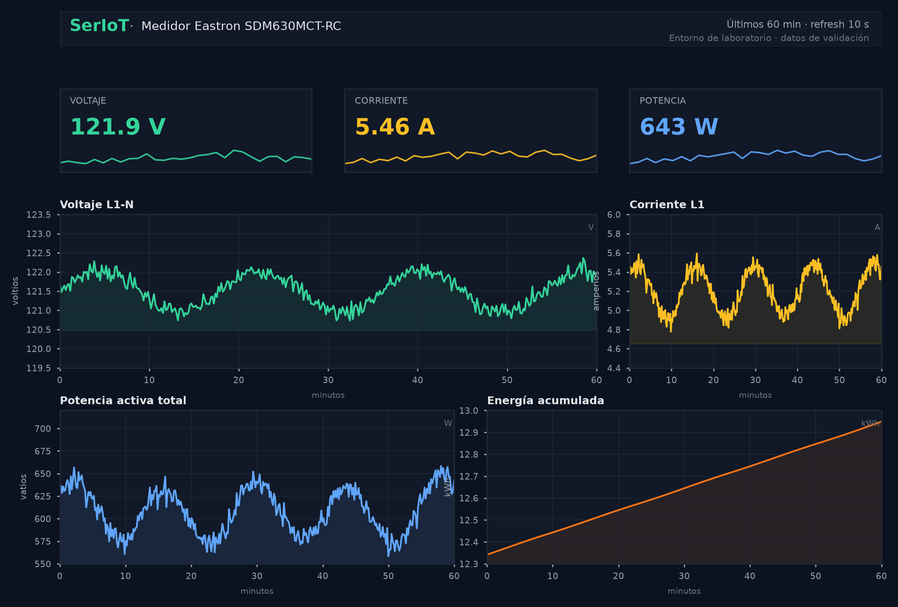
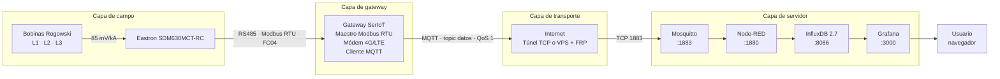

# Gateway IoT EPME-TG · Telemetría eléctrica industrial

**Plataforma autoalojada para adquirir, transmitir, almacenar y visualizar variables eléctricas industriales con el kit EPME-TG (Eastron SDM630MCT-RC + Gateway SerIoT).**

[](https://docs.docker.com/compose/)
[](https://mosquitto.org/)
[](https://nodered.org/)
[](https://www.influxdata.com/)
[](https://grafana.com/)
[](LICENSE)
[](LICENSE-DOCS.md)

<p align="center">
  
</p>

<p align="center"><em>Vista de referencia del dashboard: tensión, corriente, potencia y energía del medidor Eastron.</em></p>

---

## Descripción

Este repositorio documenta el caso de uso de **telemetría eléctrica industrial** desarrollado en el marco del proyecto **Prototipo de un Gateway IoT** (código Quipu `202010047080`, Convocatoria 930, Resolución 1129 de 2026) de la Universidad Nacional de Colombia, Sede Manizales.

El sistema integra:

- un medidor trifásico **Eastron SDM630MCT-RC** con salida RS485 y protocolo Modbus RTU;
- un **Gateway SerIoT** con módem celular 4G/LTE, maestro Modbus y cliente MQTT;
- un servidor autoalojado con **Mosquitto**, **Node-RED**, **InfluxDB 2.7** y **Grafana**, desplegado con Docker Compose.

El gateway lee las variables eléctricas del medidor, las publica como JSON por MQTT y el servidor las normaliza, almacena y visualiza en un dashboard de tiempo real e histórico. La solución utiliza protocolos abiertos, no depende de plataformas IoT propietarias y puede reproducirse con los archivos de configuración de este repositorio.

## Arquitectura



Diagramas disponibles en [`diagrams/`](diagrams/):

| Archivo | Contenido |
|---|---|
| `fig01_arquitectura.png` | Arquitectura completa por capas. |
| `fig02_campo_rs485.png` | Conexión de campo, bobinas y bus RS485. |
| `fig03_flujo_datos.png` | Recorrido del dato desde el medidor hasta el dashboard. |
| `fig04_dashboard.png` | Vista de referencia del dashboard. |
| `fig05_nodered.png` | Flujo implementado en Node-RED. |
| `fig06_cronograma.png` | Cronograma del periodo de vinculación. |

## Stack de servicios

| Servicio | Imagen | Puerto | Función |
|---|---|---|---|
| Mosquitto | `eclipse-mosquitto:2.0` | `1883` / `9001` | Broker MQTT para la ingesta de mensajes. |
| Node-RED | `nodered/node-red:4.0` | `1880` | Normalización, enrutamiento y escritura en InfluxDB. |
| InfluxDB | `influxdb:2.7` | `8086` | Base de datos de series temporales y consultas Flux. |
| Grafana | `grafana/grafana:11.2.0` | `3000` | Dashboards, fuente de datos y visualización. |

## Resultados de la validación

La sesión de validación se realizó con el medidor conectado al tablero y el gateway publicando cada 10 segundos durante una ventana de dos horas.

| Variable | Referencia del medidor | Dashboard | Error | Estado |
|---|---:|---:|---:|---|
| Tensión L1-N | 121,5 V | 121,4 V | 0,08 % | Conforme |
| Corriente L1 | 5,20 A | 5,18 A | 0,38 % | Conforme |
| Potencia activa | 631 W | 628 W | 0,48 % | Conforme |
| Energía | 12,34 kWh | 12,34 kWh | 0,00 % | Conforme |
| Frecuencia | 60,0 Hz | 60,0 Hz | 0,00 % | Conforme |
| Muestreo | 10 s | 10,0 s | — | Conforme |
| Latencia extremo a extremo | — | 1,8 s (promedio) | — | Conforme |
| Continuidad | 720 muestras | 718 válidas | 99,7 % | Conforme |

> Los valores corresponden a la ventana de validación documentada en el informe. El detalle del plan de pruebas y del análisis se encuentra en [`docs/05-plan-de-pruebas.md`](docs/05-plan-de-pruebas.md) y [`docs/06-resultados.md`](docs/06-resultados.md).

## Inicio rápido

### Requisitos

- Docker Desktop 4.x con Docker Compose v2 (Windows, macOS o Linux).
- Git.
- Una SIM 4G con plan de datos y el APN del operador para el gateway.
- Acceso a la red local o a un host con puerto TCP público para el broker.

### Despliegue

```bash
git clone https://github.com/MariaJose715/Gateway-IoT-EPME-TG.git
cd Gateway-IoT-EPME-TG

cp .env.example .env
# Edite .env y defina contraseñas y token propios.

docker compose up -d
docker compose ps
```

Servicios disponibles:

| Servicio | URL local |
|---|---|
| Node-RED | http://localhost:1880 |
| InfluxDB | http://localhost:8086 |
| Grafana | http://localhost:3000 |

En Windows también puede usar:

```powershell
.\scripts\start.ps1
```

### Configuración inicial de Node-RED

1. Abra `http://localhost:1880`.
2. Importe el flujo [`config/nodered/flows.json`](config/nodered/flows.json) si no está cargado.
3. Abra el nodo **InfluxDB** y configure la versión 2.0, la URL `http://influxdb:8086`, la organización `seriot`, el bucket `datos` y el token definido en `.env`.
4. Despliegue el flujo con **Deploy**.
5. Publique un mensaje de prueba:

```bash
./scripts/publish-test.sh
```

### Configuración inicial de Grafana

Grafana aprovisiona automáticamente la fuente de datos `InfluxDB SerIoT` y el dashboard `seriot-main`. Ingrese con el usuario y la contraseña definidos en `.env`; el dashboard se encuentra en la carpeta **SerIoT**.

## Configuración del gateway

| Parámetro | Valor utilizado | Observación |
|---|---|---|
| APN | APN del operador local | Verificar cobertura y asignación de IP. |
| IOT Server URL | Host del túnel o VPS | Sin prefijo `http://` ni `mqtt://`. |
| Puerto | `1883` | Puerto del broker Mosquitto. |
| Tópico | `datos` | Tópico de publicación de telemetría. |
| Periodo de muestreo | `10 s` | Adecuado para monitoreo energético. |
| Esclavo Modbus | `1` | Dirección del medidor Eastron. |
| Función Modbus | `04` | Input Registers. |
| Formato | JSON | Objeto con variables y marca de tiempo. |

Mensaje publicado:

```json
{
  "voltaje": 121.5,
  "corriente": 5.2,
  "energia": 12.34,
  "timestamp": "2026-11-20T15:30:00-05:00"
}
```

El mapa completo de registros Modbus, la configuración del medidor y el procedimiento de campo se describen en [`docs/04-configuracion-gateway.md`](docs/04-configuracion-gateway.md).

## Estructura del repositorio

```text
.
├── README.md
├── LICENSE
├── LICENSE-DOCS.md
├── CITATION.cff
├── CONTRIBUTING.md
├── SECURITY.md
├── .env.example
├── .gitignore
├── docker-compose.yml
├── Makefile
├── config/
│   ├── mosquitto/          # Broker y variante de producción
│   ├── nodered/            # Flujo exportado
│   ├── influxdb/           # Notas de inicialización
│   └── grafana/            # Fuente de datos y dashboard
├── diagrams/               # Diagramas de arquitectura y flujo
├── docs/                   # Caso de uso, despliegue, pruebas y resultados
├── evidence/               # Registros y capturas de la validación
├── scripts/                # Arranque, verificación y respaldo
├── tests/                  # Pruebas de payload y Modbus
├── report/                 # Informe de actividades (DOCX y PDF)
└── .github/workflows/      # Integración continua
```

## Documentación

| Documento | Contenido |
|---|---|
| [`docs/01-caso-de-uso.md`](docs/01-caso-de-uso.md) | Contexto, problema, objetivos y alcance. |
| [`docs/02-arquitectura.md`](docs/02-arquitectura.md) | Capas, componentes, flujo y modelo de datos. |
| [`docs/03-despliegue.md`](docs/03-despliegue.md) | Guía paso a paso del despliegue. |
| [`docs/04-configuracion-gateway.md`](docs/04-configuracion-gateway.md) | Medidor, registros Modbus y gateway. |
| [`docs/05-plan-de-pruebas.md`](docs/05-plan-de-pruebas.md) | Criterios de aceptación y pruebas T01–T10. |
| [`docs/06-resultados.md`](docs/06-resultados.md) | Resultados, análisis y conclusiones. |
| [`docs/07-seguridad.md`](docs/07-seguridad.md) | Laboratorio vs. producción, TLS, ACL y respaldos. |
| [`docs/08-reproducibilidad.md`](docs/08-reproducibilidad.md) | Despliegue en un equipo limpio y checklist. |

## Informe de actividades

El informe completo, con portada, Control del documento, tabla de contenido, figuras, tablas, anexos y constancia de elaboración, está disponible en:

- [`report/Informe_Actividades_Gateway_IoT_Publico.pdf`](report/Informe_Actividades_Gateway_IoT_Publico.pdf)
- [`report/Informe_Actividades_Gateway_IoT_Publico.docx`](report/Informe_Actividades_Gateway_IoT_Publico.docx)

## Pruebas

```bash
python -m pip install -r tests/requirements.txt
python -m pytest -q
```

Las pruebas verifican la normalización del payload de Node-RED y la decodificación de registros Modbus FLOAT-32.

## Seguridad

- **No** se publican credenciales, tokens ni archivos `flows_cred.json`.
- El archivo `.env` está excluido por `.gitignore`; use `.env.example` como plantilla.
- La configuración de Mosquitto incluida es para **laboratorio** (`allow_anonymous true`). Para producción use la variante con autenticación, ACL y TLS descrita en [`docs/07-seguridad.md`](docs/07-seguridad.md).
- Reporte vulnerabilidades según [`SECURITY.md`](SECURITY.md).

## Contexto académico

| Campo | Valor |
|---|---|
| Proyecto | Prototipo de un Gateway IoT |
| Código Quipu | `202010047080` |
| Convocatoria | 930 |
| Resolución | 1129 de 2026 |
| Periodo | 27 de octubre – 26 de noviembre de 2026 |
| Autora | Nayely María José Cuadros Ortega |
| Programa | Ingeniería Electrónica |
| Tutor | Prof. Gustavo Adolfo Osorio Londoño |
| Institución | Universidad Nacional de Colombia, Sede Manizales |

## Licencia

- Código y configuraciones: [MIT](LICENSE).
- Documentación, diagramas e informe: [CC BY 4.0](LICENSE-DOCS.md).

---

<p align="center">Universidad Nacional de Colombia · Facultad de Ingeniería y Arquitectura · Sede Manizales · 2026</p>
