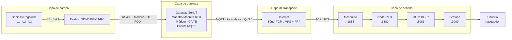

# 02 · Arquitectura

[← Anterior: Caso de uso](01-caso-de-uso.md) · [Siguiente: Despliegue →](03-despliegue.md)

## 2.1 Vista general

La solución se organiza en cinco capas. El dato nace en el tablero eléctrico, se adquiere en el gateway, viaja por la red celular y se procesa en un servidor autoalojado hasta llegar al navegador del usuario.



El código fuente del diagrama está en [`diagrams/arquitectura.mmd`](../diagrams/arquitectura.mmd) y las versiones en PNG en [`diagrams/`](../diagrams/).

## 2.2 Capas y responsabilidades

| Capa | Componente | Responsabilidad |
|---|---|---|
| Campo | Medidor Eastron SDM630MCT-RC y bobinas Rogowski | Medir tensión, corriente, potencia, frecuencia y energía; exponer los valores por RS485. |
| Gateway | Gateway SerIoT | Actuar como maestro Modbus RTU, interpretar los registros, construir el JSON y publicarlo por MQTT usando la red celular. |
| Transporte | Internet, túnel TCP o VPS con FRP | Entregar los mensajes del gateway al broker sin exigir cambios en la red del laboratorio. |
| Servidor | Mosquitto, Node-RED, InfluxDB y Grafana | Recibir, normalizar, almacenar, consultar y visualizar la telemetría. |
| Presentación | Navegador del usuario | Mostrar el dashboard y permitir consultas por rango de tiempo. |

## 2.3 Componentes del servidor

| Servicio | Imagen | Puerto | Función |
|---|---|---|---|
| Mosquitto | `eclipse-mosquitto:2.0` | `1883` / `9001` | Broker MQTT; recibe los mensajes del gateway y los entrega a Node-RED. |
| Node-RED | `nodered/node-red:4.0` | `1880` | Suscripción al tópico, normalización del payload y escritura en InfluxDB. |
| InfluxDB | `influxdb:2.7` | `8086` | Base de datos de series temporales; organización `seriot`, bucket `datos`. |
| Grafana | `grafana/grafana:11.2.0` | `3000` | Fuente de datos aprovisionada y dashboard `seriot-main`. |

Los servicios se declaran en [`docker-compose.yml`](../docker-compose.yml), comparten una red interna de Docker y se resuelven por nombre de servicio (`mosquitto`, `nodered`, `influxdb`, `grafana`). No se usan direcciones IP fijas.

## 2.4 Flujo del dato

1. **Medición.** El medidor samplea las tres fases y actualiza sus registros Modbus con las magnitudes instantáneas y acumuladas.
2. **Lectura.** El gateway, configurado como maestro Modbus, envía una petición FC04 al esclavo 1 y recibe dos registros por variable (FLOAT-32).
3. **Decodificación.** El gateway interpreta los registros según el orden de palabras configurado y aplica escalador y offset.
4. **Publicación.** El gateway arma un objeto JSON y lo publica en el tópico `datos` con QoS 1.
5. **Transporte.** El mensaje sale por la red celular y llega al puerto 1883 del broker, ya sea por un túnel TCP o por un VPS con FRP.
6. **Normalización.** Node-RED recibe el mensaje, acepta objetos, cadenas JSON, buffers o escalares y fuerza la medición `energia`.
7. **Almacenamiento.** El nodo de salida escribe los campos en InfluxDB, en el bucket `datos`, con la marca de tiempo del mensaje.
8. **Visualización.** Grafana consulta InfluxDB con Flux y actualiza el dashboard cada 10 segundos.

## 2.5 Modelo de datos

La telemetría se almacena en la medición `energia`. Cada variable es un campo numérico y la marca de tiempo proviene del gateway.

| Elemento | Valor | Observación |
|---|---|---|
| Organización | `seriot` | Definida en `.env` como `INFLUXDB_ORG`. |
| Bucket | `datos` | Definido en `.env` como `INFLUXDB_BUCKET`. |
| Retención | `30d` | Configurable con `INFLUXDB_RETENTION`. |
| Medición | `energia` | Nombre fijo para mantener el esquema. |
| Campos | `voltaje`, `corriente`, `potencia`, `energia`, `frecuencia` | Todos numéricos. |
| Etiquetas | Ninguna obligatoria | El esquema base no requiere tags; pueden añadirse para multi-sitio. |
| Marca de tiempo | ISO 8601 con zona horaria | El gateway envía `timestamp`; Node-RED lo conserva. |

Ejemplo de documento almacenado:

```json
{
  "_measurement": "energia",
  "_field": "voltaje",
  "_value": 121.5,
  "_time": "2026-11-20T20:30:00.000Z"
}
```

Consulta Flux de referencia:

```flux
from(bucket: "datos")
  |> range(start: -1h)
  |> filter(fn: (r) => r._measurement == "energia" and r._field == "voltaje")
  |> aggregateWindow(every: 1m, fn: mean, createEmpty: false)
  |> yield(name: "voltaje_promedio")
```

## 2.6 Tópicos MQTT

| Tópico | Dirección | QoS | Retención | Uso |
|---|---|---|---|---|
| `datos` | Gateway → broker | 1 | No | Telemetría del medidor. |
| `#` | Broker → Node-RED | 1 | No | Suscripción de descubrimiento del flujo. |
| `seriot/prueba` | Script de verificación | 0 | No | Mensaje de prueba para diagnosticar el broker. |

El flujo incluido se suscribe a `#` para facilitar la puesta en marcha y filtrar después. En producción conviene limitar la suscripción a `datos` y a los tópicos de control autorizados.

## 2.7 Puertos y exposición

| Puerto | Servicio | Protocolo | Exposición recomendada |
|---|---|---|---|
| `1883` | Mosquitto | MQTT | Público solo si se usa TLS y autenticación; de lo contrario, por VPN. |
| `9001` | Mosquitto | MQTT sobre WebSockets | Red local o reverse proxy con TLS. |
| `1880` | Node-RED | HTTP | Red local o VPN; no exponer a Internet sin autenticación. |
| `8086` | InfluxDB | HTTP | Red local o VPN; el acceso del dashboard es interno. |
| `3000` | Grafana | HTTP | Red local, VPN o reverse proxy con TLS. |

En el laboratorio los puertos se publican en el host para facilitar la demostración. En producción se recomienda exponer únicamente el broker y publicar Grafana mediante un proxy inverso con HTTPS. El detalle está en [`07-seguridad.md`](07-seguridad.md).

## 2.8 Identificadores y convenciones

| Recurso | Identificador | Archivo |
|---|---|---|
| Fuente de datos de Grafana | `influxdb-seriot` | `config/grafana/provisioning/datasources/influxdb.yml` |
| Dashboard | `seriot-main` | `config/grafana/dashboards/seriot-main.json` |
| Carpeta de Grafana | `SerIoT` | `config/grafana/provisioning/dashboards/dashboards.yml` |
| Medición | `energia` | `config/nodered/flows.json` |
| Tópico | `datos` | `config/nodered/flows.json` |
| Contenedores | `seriot-*` | `docker-compose.yml` |

Mantener estos identificadores estables permite actualizar el dashboard sin romper la fuente de datos ni las consultas.

## 2.9 Persistencia

| Ruta del host | Ruta del contenedor | Contenido |
|---|---|---|
| `./data/mosquitto` | `/mosquitto/data` | Persistencia del broker. |
| `./data/influxdb` | `/var/lib/influxdb2` | Base de datos, metadatos y tokens. |
| `./data/grafana` | `/var/lib/grafana` | Usuarios, preferencias y estado de Grafana. |
| `./config/nodered` | `/data` | Flujo, credenciales y módulos de Node-RED. |

La carpeta `data/` está excluida de Git. El respaldo se genera con [`scripts/backup.sh`](../scripts/backup.sh), que comprime `data/` y `config/` sin incluir `.env`.

## 2.10 Decisiones de diseño

- **Protocolos abiertos.** Modbus RTU, MQTT, Flux y HTTP permiten integrar equipos de distintos fabricantes y evitan dependencias propietarias.
- **Separación por capas.** El gateway solo adquiere y publica; el servidor normaliza, almacena y visualiza. Cada capa puede actualizarse por separado.
- **Contenedores.** Docker Compose fija versiones de imagen y hace reproducible el despliegue en Windows, macOS o Linux.
- **Series temporales.** InfluxDB está optimizada para consultas por rango de tiempo y agregaciones, que es el patrón de uso del monitoreo energético.
- **Aprovisionamiento.** Grafana recibe la fuente de datos y el dashboard desde archivos, sin configuración manual después del despliegue.
- **Seguridad por defecto en producción.** La configuración de laboratorio se separa de la variante con autenticación, ACL y TLS.

## 2.11 Diagramas disponibles

| Archivo | Contenido |
|---|---|
| `diagrams/fig01_arquitectura.png` | Arquitectura completa por capas. |
| `diagrams/fig02_campo_rs485.png` | Conexión de campo, bobinas y bus RS485. |
| `diagrams/fig03_flujo_datos.png` | Recorrido del dato desde el medidor hasta el dashboard. |
| `diagrams/fig04_dashboard.png` | Vista de referencia del dashboard. |
| `diagrams/fig05_nodered.png` | Flujo implementado en Node-RED. |
| `diagrams/fig06_cronograma.png` | Cronograma del periodo de vinculación. |
| `diagrams/arquitectura.mmd` | Código Mermaid de la arquitectura. |
